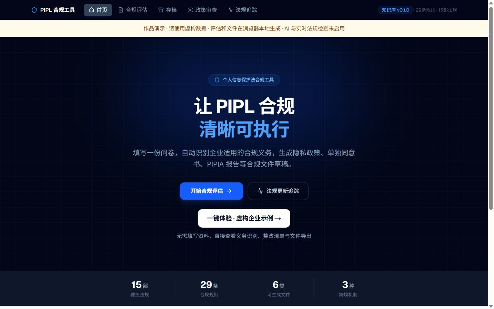
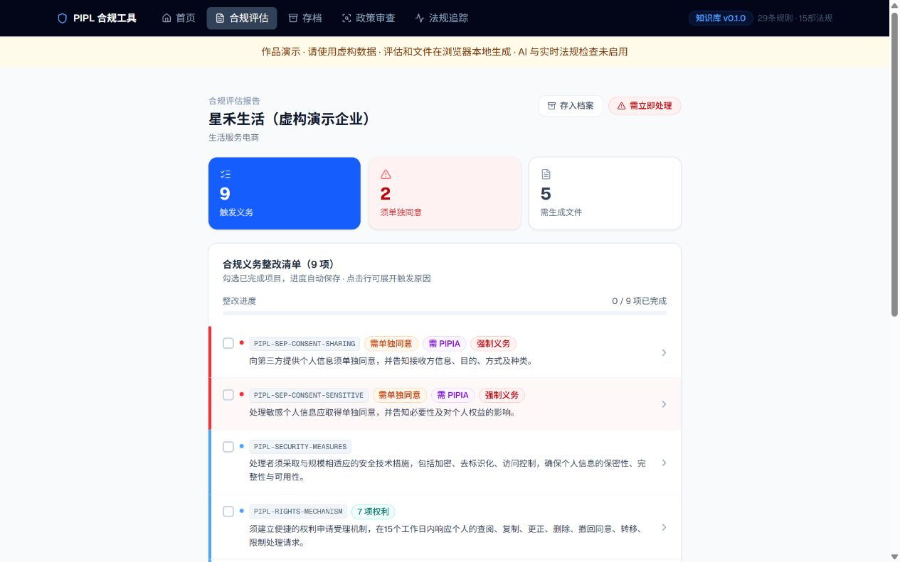

# PIPL 个人信息保护合规辅助工具

将企业基本情况和个人信息处理活动转化为可解释的合规义务清单，并生成供人工复核的合规文件草稿。这是法律科技作品原型，用于展示法律规则结构化、产品流程设计和工程实现。

**[在线体验产品](https://pipl-hr-demo-johnriver.tweedydrum.chatgpt.site)**：点击「一键体验 · 虚构企业示例」，无需注册即可查看真实规则引擎生成的报告，并下载 Word 文件。

演示路径：首页 → 一键体验 → 展开义务查看触发原因与来源 → 生成合规文件 → 下载 `.docx`。也可以自行填写虚构企业问卷。演示中的评估、文件生成和存档均在浏览器本地完成；AI 和实时法规检查未启用。





[另一个项目：《选择之后》普法互动游戏](https://github.com/johnriver1050-glitch/after-the-choice)

## 核心流程

填写企业与处理活动问卷 → 规则引擎匹配义务 → 查看触发原因及法规来源 → 生成文件草稿 → 导出与本地存档。

- **规则评估**：将法规知识库与评估引擎分离，以 YAML 管理规则，通过 Zod 校验结构。
- **解释与追溯**：报告展示义务、触发原因、来源及复核信息，便于人工判断适用性。
- **文件辅助**：提供隐私政策、同意书、影响评估等文件模板及 DOCX 导出能力。
- **辅助研究**：案例参考、官方来源页面变化检测，以及可选的 AI 义务问答与政策审查。
- **工作留存**：问卷草稿和报告存档使用浏览器本地存储。

## 技术栈

Next.js 16 / React 19 / TypeScript / Tailwind CSS / Zod / YAML / Vitest。可选 AI 功能通过服务端调用 Anthropic API。

## 本地运行

```bash
npm ci
npm run dev
```

打开 http://localhost:3000 。基础规则评估不要求配置 AI 密钥。启用 AI 功能时，在项目根目录自行创建 `.env.local`：

```dotenv
ANTHROPIC_API_KEY=your_api_key_here
```

密钥仅用于服务端，环境文件不提交到仓库。使用 AI 功能时，相应输入会发送给模型服务商，请使用虚构演示数据。

## 验证

```bash
npm test
npm run build
```

当前规则引擎包含 16 项自动化测试。测试通过表明已覆盖场景符合预期，不等于法律结论已经完成专业审核。

## 代码导航

| 路径 | 作用 |
| --- | --- |
| `app/questionnaire` | 企业与处理活动问卷 |
| `app/report` | 评估报告及义务展示 |
| `lib/engine/evaluate.ts` | 规则匹配引擎 |
| `knowledge-base` | 法规规则、来源及案例 |
| `lib/templates`、`lib/export` | 模板与文档导出 |
| `app/api/llm` | 可选 AI 服务接口 |
| `tests/engine.test.ts` | 规则引擎测试 |
| `docs/ROADMAP.md` | 后续改进规划 |

## 当前边界

这是合规辅助原型，输出需由专业人员结合事实及有效法规复核。来源页面变化检测不等同于法规修订认定；部分规则仍需持续复核。在线演示使用浏览器本地计算，不作为多用户生产服务使用。

`scripts/prepare-demo.mjs` 将原应用生成到独立 Sites 目录，复用规则引擎、知识库与文件模板，并替换服务端请求为本地执行。生成过程不复制环境文件、密钥或运行缓存；独立演示目录需先配置 `.openai/hosting.json`。运行：`node scripts/prepare-demo.mjs <独立目录>`，再在该目录执行 `npm ci` 和 `npm run build`。
